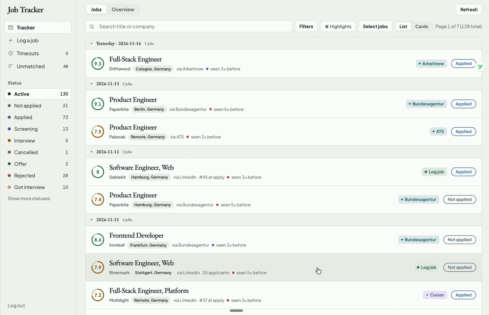
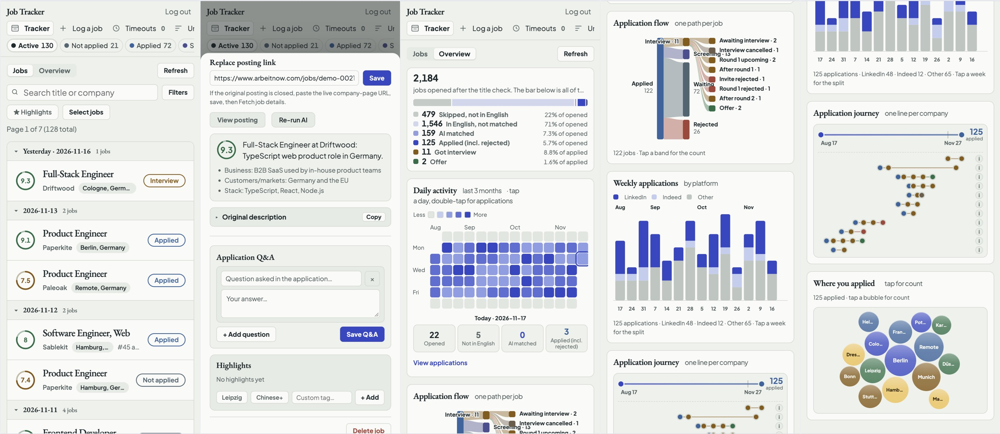

# Job Tracker

AI-assisted job search pipeline for the German market, running daily in production.

Public APIs and company ATS boards are collected on GitHub Actions and scored against my CV. Cursor and Claude run a second daily screen and push picks they already liked. Everything lands on a phone-friendly tracker plus Telegram.

**Live demo** (separate subdomain, [setup](docs/deploy.md#7-public-demo-separate-subdomain)): fictional data, no login. Soft edits (status, notes, Log Job) work; the database resets every night. Production stays private. Put the public URL here and in the GitHub About once the demo Vercel domain is live.



## Why I built it

Screening German-market listings by hand was slow. Many posts are written in German, require German as a must-have, or sit on the wrong stack. I wanted a system that throws those out first, then tells me *why* a remaining role is a fit, so I spend time on applications instead of tabs.

## What it does

- **Collects** listings every morning from Arbeitnow, the Bundesagentur für Arbeit, and ~80 company ATS boards (Greenhouse, Lever, Ashby, Personio, Recruitee, Workable).
- **Adds agent picks** from Cursor and Claude scheduled screens. Those jobs skip the matcher — the agent already did an AI pass — and land on the tracker through `POST /api/agent/jobs`. That is extra coverage beyond the API/ATS watchlist: company pages, boards I do not query, roles the automated funnel never sees. [Job sources](docs/job_sources.md).
- **Filters cheaply, then matches with AI.** Empty, non-English, and incomplete JDs never hit the model. The rest get labels, a company lookup, and a 0–10 score.
- **Tracks applications** in a login-protected web UI: status and timeline, Unmatched / Timeouts review, stats, and a log-a-job form. Built for phone as well as desktop.
- **Pushes today's matches** to Telegram.

<table>
  <tr>
    <td align="center" valign="top" width="34%">
      
    </td>
    <td align="center" valign="top" width="33%">
      
    </td>
    <td align="center" valign="top" width="33%">
      
    </td>
  </tr>
  <tr>
    <td align="center"><sub>Desktop overview</sub></td>
    <td align="center"><sub>Job detail</sub></td>
    <td align="center"><sub>Phone</sub></td>
  </tr>
</table>

<details>
<summary>Desktop overview — click to enlarge</summary>
<br>
<p align="center">
  
</p>
</details>

<details>
<summary>Job detail — click to enlarge</summary>
<br>
<p align="center">
  
</p>
</details>

<details>
<summary>Phone layout — click to enlarge</summary>
<br>
<p align="center">
  
</p>
</details>

## Architecture

Two daily ingest lanes, then one tracker.

A TypeScript pnpm monorepo. The pipeline runs on GitHub Actions and writes **directly to Neon Postgres**. Agent picks hit the tracker API on Vercel and skip the matcher. Vercel never runs collection.


| Package | Role |
|---|---|
| `apps/web` | Next.js App Router: tracker UI and route handlers (`/api/*`), session auth |
| `packages/pipeline` | Source fetchers, dedup, title gate, ingest, Telegram digest; CLIs for `sources` and `scrape` |
| `packages/matching` | JD quality and language gates, OpenAI labelling, score from weights |
| `packages/db` | Prisma schema and migrations |
| `packages/core` | Shared status model and Berlin-time helpers |

Full flow, gates, and stored fields: [architecture.md](docs/architecture.md). Matching rules the model follows: [matching_rules.md](docs/matching_rules.md). Database schema: [pg-schema.md](docs/pg-schema.md).

## Design decisions

### Deterministic checks stay in code; judgment goes to the LLM

Empty JDs, non-English JDs, and incomplete page chrome are rejected in code (`assessJobDescription`, Lingua). Those jobs are never sent to the model. The LLM only sees a usable English posting, and every hard fail has to quote the JD.

### The LLM outputs labels; code computes the score

The model returns structured labels (role type, stack fit, seniority, German requirement, company markets, …). `MATCH_WEIGHTS` in `packages/matching/src/weights.ts` turns those labels into a 0–10 score. The number is explainable, I can retune a preference (for example hardware −2.5) without rewriting prompts, and swapping models does not change the scoring logic.

### Two-layer matching, with a company cache

Layer 1 labels the job against my CV and [matching_rules.md](docs/matching_rules.md). Layer 2 (web search) runs only for jobs that passed layer 1, and only the first time a company is seen — later jobs reuse the cached company profile. Layer 1 costs about 4k input + 0.4k output tokens per job; a first-time company lookup is about 12–14k input plus search fees.

### Agent picks are a source, not a second match

Cursor and Claude already screened the posting. Running the matcher again would cost extra and could hide a pick I still want on the board. New URLs become link-only tracker cards (`origin=agent`). If the same URL is already Unmatched, it stays there and is tagged so I can see the disagreement.

### Past decisions are the eval set

Before I change a prompt, a weight, or a model, I re-score jobs I already marked applied or unsuitable (`python3 scripts/tools/eval_matcher.py`). The eval is my own Tracker history, not a public benchmark — that is a limitation, but it catches regressions against the taste the pipeline is for.

## Rewritten from Flask + MongoDB

Production is **Vercel + Neon**. The tracker started as Python (Flask, MongoDB Atlas, Render) and was rewritten in TypeScript (Next.js, Postgres) while staying in daily use. The rewrite was checked against the old app, not by eye:

- **API contract snapshots first.** Before any new code, 54 HTTP cases (every read endpoint plus the main writes) were recorded from Flask against a synthetic fixture, with a pinned clock and normalised ids. The Next.js app had to return the same JSON for every field the frontend reads. [migration-contracts.md](docs/migration-contracts.md).
- **The same browser E2E suite** (Playwright) runs against both apps, with a fake OpenAI server so Run AI costs nothing in tests.
- **A read-only parallel week**, then a cutover. A nightly job copied Mongo into Neon until Neon became the live database. [deploy.md](docs/deploy.md).
- **Scoring parity.** Matching was ported label by label, and old and new pipeline runs were compared on the same postings.

Flask on Render and MongoDB Atlas stay up for one to two weeks as a fallback. Do not use that app: its writes go to Mongo and never reach Neon.

The LinkedIn / Indeed browser scrapers are still Python (Chrome over CDP). They run on demand from my Mac; `pnpm pipeline scrape` starts them and writes their cards to Postgres.

## Tech stack

**Web:** TypeScript · Next.js 15 (App Router) · React 19 · TanStack Query · iron-session

**Data:** PostgreSQL (Neon) · Prisma

**Pipeline and matching:** Node.js 22 · OpenAI · Lingua · Telegram Bot API

**Infra and tooling:** Vercel · GitHub Actions · pnpm workspaces · Docker (local Postgres) · Vitest · Playwright

**Still Python:** LinkedIn / Indeed scrapers (Chrome CDP) and the contract / E2E test runners.

**Fallback only (1–2 weeks):** Flask + MongoDB Atlas + Render. Not the live tracker.

## Built with AI coding agents

This repo is the daily workflow, not a demo of prompting.

- I implement features with Claude Code / Cursor against project skills (matching rules, UI contracts, impact checks).
- The stack migration was done the same way, phase by phase, with the contract snapshots and the E2E suite as the check for every phase.

## Quick start

Operator details: **[docs/setup.md](docs/setup.md)**. Deploying to Vercel + Neon: **[docs/deploy.md](docs/deploy.md)**.

```bash
pnpm install                                   # Node 22, pnpm 10
pnpm db:up                                     # local Postgres in Docker
cp .env.example .env                           # pipeline: OpenAI, Telegram
cp apps/web/.env.example apps/web/.env.local   # web: session secret, login
cp packages/db/.env.example packages/db/.env   # Prisma
pnpm db migrate:dev                            # create the tables
pnpm pipeline sources --dry-run --no-match     # preview, no writes, no AI
pnpm --filter @tracker/web dev                 # http://localhost:3000
```

## Limitations and next steps

- **Single user (production).** Auth, CV, and weights are mine; this is not a multi-tenant product. The public demo is a separate deployment with fictional data and a nightly reset.
- **The eval set is small** and is my own Tracker decisions, so it will overfit my taste.
- **Run AI on a single job is local only.** Lingua's Linux binary is larger than Vercel's function size limit, so the hosted button points you to your own machine. The daily pipeline on GitHub Actions is not affected.
- **Coverage is APIs + an ATS watchlist + daily agent screens.** Jobs that never appear on a board I query, and that no agent picks that day, never enter.

Next: grow the eval set, port the eval to the Postgres stack, and tighten company coverage on the ATS watchlist.
