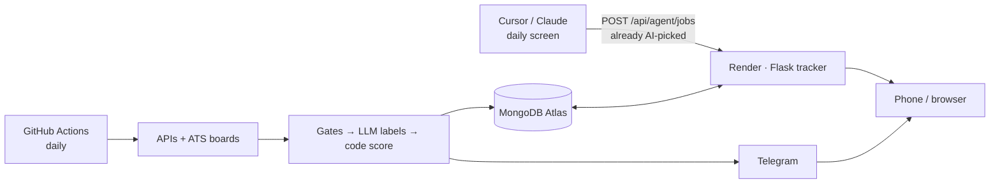

# Job Tracker

AI-assisted job search pipeline for the German market, running daily in production.

Public APIs and company ATS boards are collected on GitHub Actions and scored against my CV. Cursor and Claude run a second daily screen and push picks they already liked. Everything lands on a phone-friendly tracker plus Telegram.


## Why I built it

Screening German-market listings by hand was slow. Many posts are written in German, require German as a must-have, or sit on the wrong stack. I wanted a system that throws those out first, then tells me *why* a remaining role is a fit, so I spend time on applications instead of tabs.

## What it does

- **Collects** listings every morning from Arbeitnow, the Bundesagentur für Arbeit, and ~80 company ATS boards (Greenhouse, Lever, Ashby, Personio, Recruitee, Workable).
- **Adds agent picks** from Cursor and Claude scheduled screens. Those jobs skip the matcher — the agent already did an AI pass — and land on the tracker through `POST /api/agent/jobs`. That is extra coverage beyond the API/ATS watchlist: company pages, boards I do not query, roles the automated funnel never sees. [Job sources](docs/job_sources.md).
- **Filters cheaply, then matches with AI.** Empty, non-English, and incomplete JDs never hit the model. The rest get labels, a company lookup, and a 0–10 score.
- **Tracks applications** in a login-protected web UI: status and timeline, Unmatched / Timeouts review, stats, and a log-a-job form. Built for phone as well as desktop.
- **Pushes today's matches** to Telegram.

<table>
  <tr>
    <td align="center" valign="top" width="34%">
      
    </td>
    <td align="center" valign="top" width="33%">
      
    </td>
    <td align="center" valign="top" width="33%">
      
    </td>
  </tr>
  <tr>
    <td align="center"><sub>Desktop overview</sub></td>
    <td align="center"><sub>Job detail</sub></td>
    <td align="center"><sub>Phone</sub></td>
  </tr>
</table>

<details>
<summary>Desktop overview — click to enlarge</summary>
<br>
<p align="center">
  
</p>
</details>

<details>
<summary>Job detail — click to enlarge</summary>
<br>
<p align="center">
  
</p>
</details>

<details>
<summary>Phone layout — click to enlarge</summary>
<br>
<p align="center">
  
</p>
</details>

## Architecture

Two daily ingest lanes, then one tracker.

The collector and matcher write **directly to MongoDB Atlas**. Agent picks hit the tracker API on Render and skip the matcher. Render never runs collection.



Full flow, gates, and stored fields: [architecture.md](docs/architecture.md). Matching rules the model follows: [matching_rules.md](docs/matching_rules.md).

## Design decisions

### Deterministic checks stay in code; judgment goes to the LLM

Empty JDs, non-English JDs, and incomplete page chrome are rejected in code (`assess_job_description`, Lingua). Those jobs are never sent to the model. The LLM only sees a usable English posting, and every hard fail has to quote the JD.

### The LLM outputs labels; code computes the score

The model returns structured labels (role type, stack fit, seniority, German requirement, company markets, …). `MATCH_WEIGHTS` in `src/core/config.py` turns those labels into a 0–10 score. The number is explainable, I can retune a preference (for example hardware −2.5) without rewriting prompts, and swapping models does not change the scoring logic.

### Two-layer matching, with a company cache

Layer 1 labels the job against my CV and [matching_rules.md](docs/matching_rules.md). Layer 2 (web search) runs only for jobs that passed layer 1, and only the first time a company is seen — later jobs reuse `company_profiles`. Layer 1 costs about 4k input + 0.4k output tokens per job; a first-time company lookup is about 12–14k input plus search fees.

### Agent picks are a source, not a second match

Cursor and Claude already screened the posting. Running the matcher again would cost extra and could hide a pick I still want on the board. New URLs become link-only tracker cards (`origin=agent`). If the same URL is already Unmatched, it stays there and is tagged so I can see the disagreement.

### Past decisions are the eval set

Before I change a prompt, a weight, or a model, I re-score jobs I already marked applied or unsuitable (`python3 scripts/tools/eval_matcher.py`). The eval is my own Tracker history, not a public benchmark — that is a limitation, but it catches regressions against the taste the pipeline is for.

## Tech stack

Python 3.12 · Flask · gunicorn · MongoDB Atlas · OpenAI · Lingua · GitHub Actions · Render · Telegram Bot API

## Built with AI coding agents

This repo is the daily workflow, not a demo of prompting.

- I implement features with Claude Code / Cursor against project skills (matching rules, UI contracts, impact checks).
- After Claude edits web code, a Stop hook (`scripts/e2e_hook.sh`) runs unit tests and browser E2E tests against a throwaway MongoDB. A failure is sent back to Claude to fix; the same failure is reported once.

## Quick start

Operator details live in **[docs/setup.md](docs/setup.md)**. Deploying the UI: **[docs/deployment/RENDER_SETUP.md](docs/deployment/RENDER_SETUP.md)**.

```bash
cp .env.example .env          # MongoDB, OpenAI, tracker login
pip3 install -r requirements.txt
python3 src/sources/run_sources.py --dry-run
./scripts/start_ui.sh
```

## Limitations and next steps

- **Single user.** Auth, CV, and weights are mine; this is not a multi-tenant product.
- **The eval set is small** and is my own Tracker decisions, so it will overfit my taste.
- **Render's free plan cold-starts** after about 15 minutes idle (about 20–30s on the next open).
- **Coverage is APIs + an ATS watchlist + daily agent screens.** Jobs that never appear on a board I query, and that no agent picks that day, never enter.

Next: grow the eval set, and tighten company coverage on the ATS watchlist.
